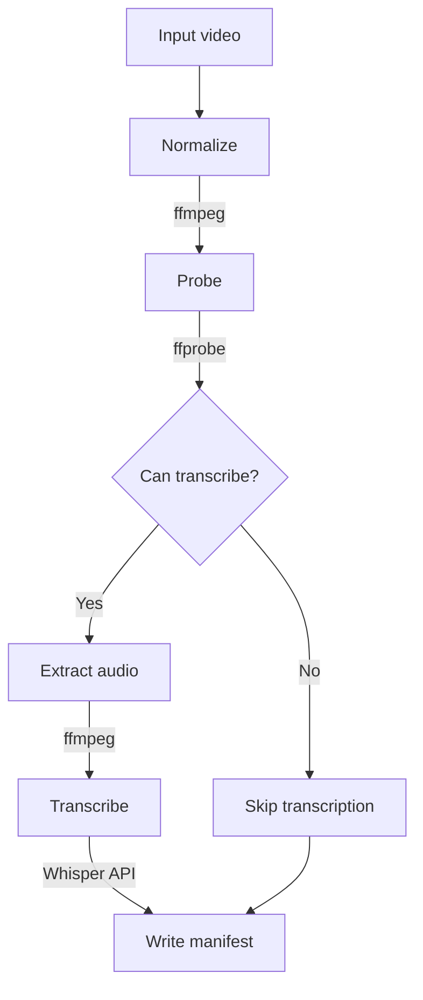

# influenca

Say it like `influenza` but with a a `c`

```shell
npm install influenca
influenca ~/my-media --exif
```

## Content intake

### SD card / USB drive (WSL)

Move `avi` / `wav` files from a Windows drive (e.g. `G:`) to a timestamped folder,
then print the ready-to-run `accession` command:

```sh
./scripts/intake.sh g
```

### Android phone (MTP via Windows Shell)

Phone enumeration and file copying require the Windows Shell COM API (MTP).
Run this from **PowerShell 7 on Windows** (`pwsh.exe`):

```powershell
# Defaults: first MTP device found, last 7 days of media
pwsh.exe -File scripts\intake-android.ps1

# Target a specific phone by partial name, copy last 3 days
pwsh.exe -File scripts\intake-android.ps1 -PhoneName "Pixel" -MaxAgeDays 3

# Copy ALL camera files (no age filter)
pwsh.exe -File scripts\intake-android.ps1 -PhoneName "Galaxy" -MaxAgeDays 0
```

Or invoke it directly from a WSL terminal (requires `pwsh.exe` on the Windows `PATH`):

```bash
pwsh.exe -File "$(wslpath -w ./scripts/intake-android.ps1)"
```

The script automatically resolves your WSL home directory and prints a
**WSL-native, pasteable** next-step command — no Windows paths leak into the output:

```
✨ Next step — paste into your WSL terminal:

  influenca accession ~/.local/state/influenca/2026-09-28_17-30-00/pixel-9-pro
```

## Development

- Install dependencies:

```bash
pnpm install
```

### Source-first monorepo baseline

The workspace is source-first for local development.

- Typecheck and tests run from source across workspace packages.
- `core` is never built on its own. Its package exports point at `src/index.ts`, and the cli bundles it.
- `cli` is the only build target: `pnpm build` writes `packages/cli/dist/bin.mjs`.
- Third-party dependencies are consumed from `node_modules` (external), not bundled.
- Dependency ownership: each package declares only what it directly imports in source.

In practice: use `pnpm lint`, `pnpm typecheck`, and `pnpm test` as the default feedback loop. Run `pnpm build` when you need a runnable cli.

- Build the cli:

```bash
pnpm run build
```

- Run CLI end-to-end smoke test:

```bash
./scripts/e2e-all.sh
```

- Typecheck all projects:

```bash
pnpm run typecheck
```

- Lint all projects:

```bash
pnpm run lint
```

- Test all projects:

```bash
pnpm run test
```

## Speech-to-Text Transcription

Transcription is implemented in the current pipeline, but it only runs when the input has an audio stream and `OPENAI_API_KEY` is set. The workflow uses `fluent-ffmpeg` for media handling and OpenAI's Whisper API for transcription.

### Workflow



### Tools In Use

- `ffmpeg` via `fluent-ffmpeg` for transcoding and audio extraction
- `ffprobe` via `fluent-ffmpeg` for duration, frame count, and stream detection
- OpenAI Whisper API for transcription
- `fs` and `path` for local file and manifest handling

The manifest is written to `tmp/processed_videos/<timestamp>/.influenca.json` after each run.
