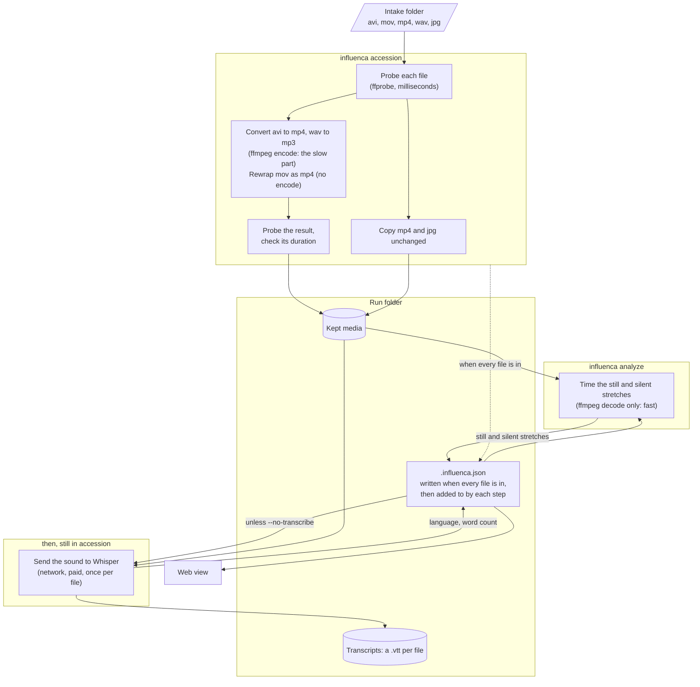

# Influenca

Take a folder of media off a camera or phone, keep it in a lasting form with a
record of what was kept, then transcribe it, measure it and browse it.

The model is a museum's. A pile of files left on the doorstep is the **intake**.
**Accession** brings the supported ones inside, converts them to formats that
last, and writes a **manifest** of what it kept. The intake is never touched and
is yours to keep or wipe. On the way in, what is said in each file is written
down as subtitles. **Analyze** then studies what is inside, as often as you
like. Everything known about a run is kept in that one manifest: each step
adds what it finds, and it drives the web page, where you curate: give a file a
title, or mark the ones you do not want.

## How it works



The steps take very different amounts of time. Accession re-encodes video,
which runs at a few times playback speed, and then waits on OpenAI for the
transcripts. Analyze only decodes, at thumbnail size, and gets through the same
footage many times faster.

Transcribing is the only step that uses the network or costs money. It happens
after the manifest is written, so a run is whole before anything is sent, and
nothing that goes wrong with OpenAI can cost you the run.

## Getting started

Influenca is run from a clone of this repository; it is not installed. Its
settings sit in a `.env` at the root of the clone, so that is where every
command here is typed.

It needs a recent Node (developed on 24), pnpm, and `ffmpeg` with `ffprobe` on
your `PATH`. HEIC stills from an iPhone or iPad also need `heif-convert`; on
Ubuntu, `apt install libheif-examples libheif-plugin-libde265`.

```sh
git clone https://github.com/GaryB432/influenca.git
cd influenca
pnpm install
cp .env.example .env   # set INFLUENCA_MEDIA_DIR, where runs are kept
                       # and OPENAI_API_KEY, to have what is said transcribed
pnpm build
pnpm influenca --help
```

The command runs what was last built. After pulling changes, or changing the
code, build again:

```sh
git pull
pnpm install && pnpm build
```

## Intake

Accession takes any folder. These two scripts fill one from a device and print
the accession command to run next.

### SD card or USB drive (WSL)

Mounts a Windows drive letter, moves its `avi` and `wav` files into a
timestamped folder under `~/.local/state/influenca/`, and clears them off the
card:

```sh
./scripts/intake.sh g
```

### Phone, tablet or camera (any device in "This PC")

Uses the Windows Shell COM API (`Shell.Application`) — the same thing Windows
Explorer uses — to discover and browse whatever is plugged in. Any device that
appears under "This PC" is reachable: Android phones, iPhones, iPads, and
anything else Windows recognises as a portable device. No adb, no iTunes, no
vendor drivers beyond what Windows installs automatically when you first connect
the device and tap "Allow" or "File Transfer".

```powershell
# Whichever device is plugged in, last 7 days of camera files
pwsh.exe -File scripts\intake-device.ps1

# A specific device by partial name, last 3 days
pwsh.exe -File scripts\intake-device.ps1 -DeviceName "Pixel" -MaxAgeDays 3

# Every camera file from an iPad, regardless of age
pwsh.exe -File scripts\intake-device.ps1 -DeviceName "iPad" -MaxAgeDays 0
```

Videos, sound and stills (JPEG or HEIC) are copied; accession turns HEIC into
JPEG. A Live Photo is a still with a short clip under the same name; only the
still is taken unless you pass `-KeepLiveClips`.

Or start it from a WSL terminal, with `pwsh.exe` on the Windows `PATH`:

```sh
pwsh.exe -File "$(wslpath -w ./scripts/intake-device.ps1)"
```

It copies into your WSL home and prints the next command, to paste at the repo root:

```
pnpm influenca accession "/home/you/.local/state/influenca/2059-05-20_00-00-00/ipad-pro"
```

## Accession

```sh
pnpm influenca accession /path/to/intake                 # -> $INFLUENCA_MEDIA_DIR/<timestamp>/
pnpm influenca accession /path/to/intake --dry-run       # show the plan, write nothing
pnpm influenca accession /path/to/intake --out-dir runs  # -> runs/<timestamp>/
pnpm influenca accession /path/to/intake --out-dir runs/one --no-timestamp
pnpm influenca accession /path/to/intake --no-transcribe # keep the files, send nothing to OpenAI
```

Leave the intake folder off and you are asked for it. Only the top level of the
folder is read, and files of other types are left behind (`--verbose` lists them).

| Arrives as              | Kept as   | How                                               |
| ----------------------- | --------- | ------------------------------------------------- |
| `.avi`                  | `.mp4`    | Converted to H.264 with AAC sound                 |
| `.wav`                  | `.mp3`    | Converted                                         |
| `.mov`                  | `.mp4`    | Rewrapped: same picture and sound, not re-encoded |
| `.mp4`, `.jpg`, `.jpeg` | unchanged | Copied under its own name                         |

- The converted file is the only copy influenca keeps, so the encode settings
  favour quality over size. They live in `apps/cli/src/convert.ts`.
- Each file is written under a `.part-` name and renamed when it is complete and
  its duration matches the source, so a file with its real name is always whole.
- The manifest is written last. A run folder without one did not finish, and a
  folder that already has one is never written into again.
- Two intake files that would be kept under the same name (`a.avi` and `a.mp4`)
  stop the run before anything is written.

## Transcripts

Once the manifest is written, accession sends the sound of each file to OpenAI's
`whisper-1` and writes what comes back as WebVTT beside the file, under the
name players look for: `VID00010.vtt` for `VID00010.mp4`. It needs
`OPENAI_API_KEY` in `.env`. Without one, or if OpenAI cannot be reached, the
run is still kept and accession tells you how to finish:

```sh
pnpm influenca transcribe              # newest run under $INFLUENCA_MEDIA_DIR
pnpm influenca transcribe /path/to/run
pnpm influenca transcribe --redo       # send every file again, and pay again
```

`transcribe` does only what is left to do, so it is also how a run accessioned
with `--no-transcribe` gets its transcripts later.

- Only sound leaves your machine, as mono mp3 at 32 kb/s. OpenAI charges by the
  minute of audio.
- Each file is sent once. What came of it (the language Whisper heard, the word
  count) is recorded on the file's entry in the manifest, saved after every
  file, so a run that stops has lost nothing. Run it again and it sends what is
  left.
- A file with less than a second of sound above -40 dB is not sent, and is
  recorded as `silent`. Whisper invents words for silence.
- A file OpenAI turns down, such as one over its 25 MB upload limit (about 100
  minutes), is recorded as `failed` with the reason and not sent again.
- Any other failure, such as a refused key or no network, stops the
  transcribing there. What was done is kept.

The model and the audio settings are in `apps/cli/src/whisper.ts`.

## Analyze

```sh
pnpm influenca analyze                 # newest run under $INFLUENCA_MEDIA_DIR
pnpm influenca analyze /path/to/run
pnpm influenca analyze --redo          # measure again
pnpm influenca analyze --minimal       # manifest totals only; measures and writes nothing
pnpm influenca analyze -l spanish      # the language you expect to hear (default english)
```

```
✓   1  AUD00000.mp3  audio  00:02:22    silent 44%  212 words
✓  10  VID00010.mp4  video  491 frames  21.1 Mb/s  still 0%  silent 0%  9 words (spanish)
```

Every file has a row from the start, and each fills in as it is measured. The
number is the file's manifest id, the same one the web page shows. Accession
and transcribe draw their work the same way. Piped to a file, each row is
written once, when it is done.

- **still**: share of a video in which the picture did not change for two
  seconds or more.
- **silent**: share of the sound below -40 dB for a second or more.
- **Mb/s**: size over duration. At a fixed quality a busier picture costs more
  bits, so it is a rough hint of activity.
- **words**: how much was said, if the run has been transcribed, with the
  language when it is not the one you expected. Analyze only reads this; it
  never calls OpenAI.

The thresholds are in `apps/cli/src/measure.ts`. What is measured is saved
on each file's entry in the manifest and reused on the next run unless you pass
`--redo`.

## What a run folder holds

```
2059-05-20T00-00-00Z/
  VID00010.mp4
  VID00010.vtt
  AUD00000.mp3
  AUD00000.vtt
  .influenca.json              the manifest: one entry per kept file
```

Each manifest entry records the kept file's name, size, duration, frame count,
dimensions and codecs, plus `sourceName`, the name it arrived under. As the
other steps run it gains what was heard (`transcript`), what was measured
(`analysis`), and what you set on the web page (`title`, `deleted`).

The manifest is version 1. Transcript, analysis and curation data are stored
directly on each entry in `.influenca.json`; manifests with another or missing
version are rejected.

## Web

```sh
pnpm dev:web
# http://localhost:4000/view/<run-folder-name>   (/view for a --no-timestamp run)
```

Shows each file in a run with a player, a thumbnail, what the analysis measured
and what was said. Videos play with their transcript as captions. Each file
carries its manifest id, the number it goes by in the CLI.

Each file also shows where it sits on disk, with a button to copy the path, for
when you want it in a project. Under WSL the Windows form of the path is there
too.

This is also where you say what a file is. Watch `PXL_20261010_175159748.mp4`,
type `Pool b-roll` and **Save**, and the page shows it under that title from then
on. Tags go in the box beside the title, separated by commas, and each one
shows on the file as a link that shows only the files with that tag. **Delete** marks a file as unwanted and dims it; **Restore** takes the mark
off. Both are recorded in the manifest, and neither renames or removes the
file itself.

Apart from those two it only reads a run folder. Thumbnails are made with ffmpeg when first asked
for and held in memory.

## Export

```sh
pnpm influenca export --to ~/projects/garden-party/media   # asks which run
pnpm influenca export /path/to/run --to /some/folder
pnpm influenca export --to /some/folder --only 3 --only 7  # by number, without being asked
pnpm influenca export --to /some/folder --tag interview     # only the titled files tagged interview
```

```
✓  1  Pool b-roll  PXL_20261010_175159748.mp4  copied as pool-b-roll.mp4
✓  4  Candles      PXL_20261011_043342083.mp4  copied as candles.mp4
```

Copies the files you have given a title on the web page into a folder, each
under a filename made from its title, with its subtitles beside it. Giving a
file a title is how you pick it: untitled files and deleted ones stay behind.
At a terminal you are shown the titled files to tick; a script gets all of them.

Leave the run off and you are asked which, from the same list as the front page
of the web app. A script is not asked, and gets the newest run.

- The run is left as it is. Export copies, and never moves or renames.
- The filename is the title in lowercase, with a hyphen wherever it has spaces
  or punctuation: `Pool b-roll` becomes `pool-b-roll.mp4`.
- A file already in the folder under that name is left alone, so exporting
  again brings only what is new.
- Leave `--to` off and you are asked for the folder.
- `--tag` takes only the titled files with that tag, and the tick list shows
  only those.

[event | Apple Developer Documentation](https://developer.apple.com/documentation/professional-video-applications/event)

## Development

Working on influenca is the same clone and the same folder. Nothing is
published and there is nothing to link.

### Layout

| Path              | What                                                             |
| ----------------- | ---------------------------------------------------------------- |
| `apps/cli`        | The `influenca` command                                          |
| `apps/web`        | SvelteKit viewer                                                 |
| `packages/core`   | Manifest, transcripts and analysis types, readers, summary       |
| `scripts/e2e.sh`  | Builds, then runs accession and analyze on a generated clip      |
| `scripts/intake*` | Fill an intake folder from an SD card or any device in "This PC" |

`CLAUDE.md` holds the rules the code relies on, for people as much as for
agents: who may write which file, how options reach a command and how the
CLI talks.

### Building

```sh
pnpm build                            # everything, once
pnpm --filter @influenca/cli dev      # rebuild the CLI as you edit it
pnpm dev:web                          # the viewer, reloading as you edit it
```

### Checks

```sh
pnpm lint && pnpm typecheck && pnpm test
sh scripts/e2e.sh
```

The tests and the e2e script generate small real clips, so they need ffmpeg too.
Run all four before opening a pull request.
