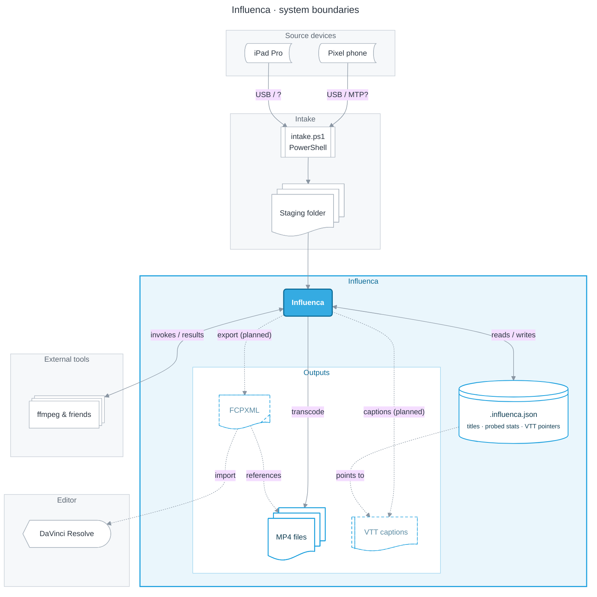

# @influenca/web

SvelteKit web app for browsing generated cloud artifacts (videos and transcripts).

## Prerequisites

Install workspace dependencies from the repository root:

```bash
pnpm install
```

## Development

From repository root:

```bash
pnpm --filter @influenca/web run dev
```

Or from this directory:

```bash
pnpm run dev
```

## Build

From repository root:

```bash
pnpm --filter @influenca/web run build
```

Or from this directory:

```bash
pnpm run build
```

Note: this project uses `@sveltejs/adapter-node` and emits a Node-compatible server build.

## Preview

From this directory:

```bash
pnpm run preview
```

## Quality Checks

- Type and Svelte checks:

```bash
pnpm run check
```

- Unit tests:

```bash
pnpm run test
```

From repository root, you can run all workspace checks with:

```bash
pnpm run check
```

## Boundaries


